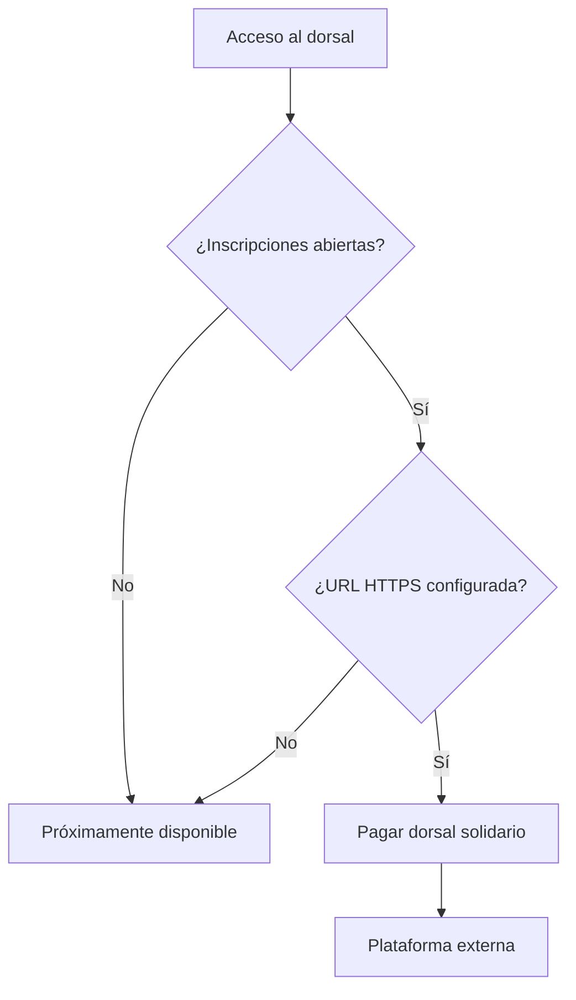

# Flujos y reglas de negocio

## Dorsal solidario

La portada, la causa y el bloque de inscripciones comparten `DorsalSolidario` y `solidarityRegistration()`. No redirigir a Contacto, a un listado genérico ni a la portada de otro servicio. El usuario debe llegar al enlace específico configurado por la organización. Cerrar inscripciones desactiva la navegación, pero conserva el enlace para volver a abrir.

Se permite abrir únicamente el dorsal solidario: no es obligatorio tener una prueba deportiva abierta. El servidor exige que exista al menos un enlace de inscripción de una prueba publicada o del dorsal solidario para habilitar el estado global.

## Inscripción deportiva

El visitante consulta una ficha y accede a Inscripciones. Cuando el evento está abierto, cada prueba con destino configurado muestra «Inscribirme» hacia ese destino. Una prueba sin URL informa de que su inscripción está pendiente. El sitio no recoge ni cobra participantes dentro de esta implementación.

## Publicación de contenido

La organización inicia sesión, crea o edita un registro, decide su visibilidad y guarda. El servidor valida sesión, Origin, campos y revisión. Tras el éxito se actualiza el estado local; en una lectura pública nueva aparecen solo registros publicados. Si hay conflicto 409 se informa y se exige revisar la versión actual.

## Galería

Los álbumes pueden mantener un enlace externo histórico y/o incorporar fotos propias. Las imágenes se suben primero al servidor; el álbum guarda sus URLs. La vista pública abre las fotos propias en un visor ampliado o, si no hay fotos propias, permite abrir el álbum original. La selección de edición filtra álbumes sin inventar fotografías de años concretos.

## Clasificaciones

El administrador elige carrera y edición, selecciona un CSV, revisa la asignación de columnas y la vista previa, pulsa «Usar estos resultados» y guarda. Un CSV reemplaza todos los participantes del mismo registro; no se mezclan importaciones. Solo puede existir una clasificación por carrera y edición. La web pública dibuja la tabla desde las filas normalizadas y permite buscar participantes por nombre, dorsal o club, filtrar por categoría/sexo y paginar. El Dorsal Solidario se excluye en los selectores, en los listados y en la validación de nuevas clasificaciones del servidor. Véase [contrato CSV](13_CLASIFICACIONES_CSV.md).

## Fecha y contador

Sin fecha, informar «Fecha por confirmar» y mostrar guiones en el contador. Con fecha, calcular días, horas, minutos y segundos respecto al instante real. Evitar valores negativos. `countdown=false` oculta el reloj y deja la información de fecha. El rótulo retirado encima del reloj no debe reaparecer.

## Patrocinadores y colaboradores

Mismo modelo de edición y mismas reglas: imagen, nombre, enlace opcional, orden y publicación. Si hay web configurada, abrirla en otra pestaña. Si no la hay, el logo es informativo. No deducir dominios a partir del nombre de la empresa.

## Contacto

El formulario valida los datos y prepara un `mailto:` con asunto y cuerpo. Se informa de que el envío se completa en el cliente de correo. No mostrar «mensaje enviado» como si hubiera un backend de correo.
